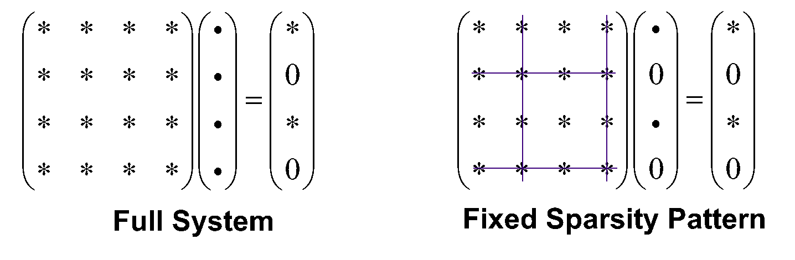

## 6.5.3 Numerical Sparsity Based Implementation

(July 4, 2026)

Recently in 2025, we developed a new local correlation formalism[[1431]](../bib_references/bib.md#bib1493)

based on numerical sparsity. The goal for this new formalism is to be as
close as the canonical RI-MP2 as possible, with the consideration of only
having one user input parameter for desired accuracy.

**Right now, the code works for elements up to xenon for restricted and unrestricted
SCF references.**

The MP2 energy is

<a id="eq:lmp2_energy"></a>

$$
E^{(2)}=\sum_{iajb}{J_{ab}^{ij}\tau_{ab}^{ij}}\;, \tag{6.19}
$$

where $\mathbf{J}$ (and the exchange-like tensor $\mathbf{K}$) is the electron repulsion integral (ERI) tensor

<a id="Ch6.E20"></a>

$$
J_{ab}^{ij}=K_{ba}^{ij}=(ia|jb)\;. \tag{6.20}
$$

$\boldsymbol{\tau}$ is the solution to the MP2 equation

<a id="eq:lmp2_equation"></a>

$$
\mathbf{\Delta}\tau=-\left(2\mathbf{J}-\mathbf{K}\right)\;, \tag{6.21}
$$

which is a set of linear equations and with orthogonal orbitals, $\Delta$ is

<a id="eq:Delta"></a>

$$
\Delta_{iajb,i^{\prime}a^{\prime}j^{\prime}b^{\prime}}=\delta_{ii^{\prime}}\delta_{aa^{\prime}}\delta_{jj^{\prime}}F^{\text{virt}}_{bb^{\prime}}-\delta_{ii^{\prime}}\delta_{aa^{\prime}}F^{\text{occ}}_{jj^{\prime}}\delta_{bb^{\prime}}+\delta_{ii^{\prime}}F^{\text{virt}}_{aa^{\prime}}\delta_{jj^{\prime}}\delta_{bb^{\prime}}-F^{\text{occ}}_{ii^{\prime}}\delta_{aa^{\prime}}\delta_{jj^{\prime}}\delta_{bb^{\prime}}\;. \tag{6.22}
$$

We compute and store the $\mathbf{J}$ tensor in a numerical sparsity way,
meaning that for each significant $i,j$ pair, we store two "ragged lists" of significant
$a,b$ indeces and their integral values. The main approximation made by us is the
"fixed sparsity pattern approximation", which means we fixed the solution $\mathbf{\tau}$
to have the same sparsity pattern (same list of significant $a,b$ indices), see Fig [6.1](#fig:lmp2_fsp).



*Figure 6.1: Fixed sparsity pattern approximation.*

The code is called by setting LMP2 option for CORRELATION.
Localization must be specified in LOCOOCCVIRT. AO linear dependency
is treated differently for different localization schemes.

### `LOCOOCCVIRT`

> **Localizes MO orbitals.**
>
> * **Type**: `INTEGER`
> * **Default**: `1`
> * **Options**:
>     * `2`: Repeatedly remove basis functions when linear dependency is present. This will CHANGE SCF result but work with VV-HV.
> * **Recommendation**: Use 2 since VV-HV is preferred. The reason that a non-default is recommended is that it will result in different SCF energies.

Different methods for localizing orbitals can be chosen. $\lambda$-Boys is recommended for the occupied space.
$\lambda$-Boys tries to minimize the total orbital spread and the total off-diagonal
Fock at the same time.

<a id="Ch6.E23"></a>

$$
f^{\text{min}}_{\lambda\text{-Boys}}=\sum_{i}\left|\langle i|\mathbf{r}-\langle i|\mathbf{r}|i\rangle|i\rangle\right|^{2}+\lambda\sum_{i\neq j}\;.(F^{\text{occ}}_{ij})^{2}. \tag{6.23}
$$

Boys orbitals (minimizing the total orbital spread) are obtained if $\lambda=0$, whereas canonical orbitals
(minimizing off-diagonal elements of the Fock matrix) are obtained as $\lambda\to\infty$. The value
$\lambda=100$ is recommended.

### `method`

> **Defines the method to localize the occupied space. INPUT SECTION: $localocc**
>
> * **Type**: `STRING`
> * **Default**: `newboys`
> * **Options**:
>     * `newboys, cholesky, pipekmezey`
> * **Recommendation**: Use the default since $\lambda$ -Boys orbitals are shown to be very effective.

### `lambda`

> **Defines $\lambda$ . INPUT SECTION: $localocc**
>
> * **Type**: `FLOAT`
> * **Default**: `0`
> * **Options**:
>     * `100`: Preferred parameter
> * **Recommendation**: Using larger $\lambda$ will decrease the accuracy of the local MP2 code.

VV-HV is the recommended localization method for the virtual space.

### `method`

> **Defines the method to localize the virtual space. INPUT SECTION: $localvirt**
>
> * **Type**: `STRING`
> * **Default**: `VV-HV`
> * **Options**:
>     * VV-HV, NewBoys, PipekMezey, PAO
> * **Recommendation**: Use the default.

Thresholds control the accuracy-efficiency tradeoff.
Normally, the user only need to specify the main threshold ($\epsilon$),
to control what elements to retain in $\mathbf{J}$.

### `thresh`

> **Defines the main threshold $\epsilon$ . INPUT SECTION: $localmp2**
>
> * **Type**: `INTEGER`
> * **Default**: `60`
> * **Options**:
>     * `55 (`: $\epsilon=10^{-5.5}$ , close to VeryTight in DLPNO-MP2), 50, 60, 65, 70
> * **Recommendation**: The default typically recovers 99.997% correlation energy and has 0.1 kcalmol energy difference error. The error scales linearly with $\epsilon$ , meaning that using 50 will accelerate the code by 3 to 5 times but the error will also be 10 $\times$ bigger.

All other thresholds for inner prescreening are listed here, they can be changed similarly.
The default $i\rightarrow a$ pre-screener threshold is

<a id="eq:lmp2_i_to_a"></a>

$$
\epsilon_{i\rightarrow a}=\left\{\begin{aligned} &\displaystyle 10^{-2.5}\epsilon&\displaystyle\epsilon\geq 10^{-6},\\
&\displaystyle 10^{3.5}\epsilon^{2}&\displaystyle\epsilon<10^{-6}.\end{aligned}\right. \tag{6.24}
$$

| Threshold | Handle | Default | Note |
| --- | --- | --- | --- |
| $\epsilon$ | thresh | $10^{-6}$ | user specified main parameter |
| $\epsilon_{i\to j}$ | thresh $\_$ uFERF | $10^{-2}\epsilon$ |  |
| $\epsilon_{i\to a}$ | thresh $\_$ ia | Eq. 6.24 |  |
| $\epsilon_{i\to P}$ | thresh $\_$ iP | $10^{2}\epsilon^{2}$ |  |
| $\epsilon_{i\to\mu}$ | thresh $\_$ coeff $\_$ occ | $\epsilon$ |  |
| $\epsilon_{a\to\nu}$ | thresh $\_$ coeff $\_$ virt | $10^{-4}$ | fixed default |
| $\epsilon_{\text{solve}}$ | thresh $\_$ sol | $5\sqrt{\epsilon}$ | residue in the linear equation solver |
| $\epsilon_{i\xrightarrow{p}a}$ | thresh $\_$ pre $\_$ ia | $\sqrt{10}\epsilon$ | pre-screeners for computing $i\to a$ pre-screener |
| $\epsilon_{i\xrightarrow{p}P}$ | thresh $\_$ pre $\_$ iP | $\sqrt{10}\epsilon_{i\to P}$ |  |
| $\epsilon_{\mu\xrightarrow{p}P}$ | thresh $\_$ pre $\_$ muP | $10^{-3}\epsilon_{i\to a}$ |  |

Table 6.2: 
Thresholds in the numerical sparsity based local MP2 code.

$\kappa$-MP2 and second-order size-consistent Brillouin-Wigner theory (BWs2, Section [6.8](topic_bws2.md)) are also supported
but cannot both be enabled at the same time.

### `regularize`

> **Defines $1000\kappa$ in $\kappa$ -MP2. INPUT SECTION: $localmp2**
>
> * **Type**: `INTEGER`
> * **Default**: `0`
> * **Options**:
>     * `1450`: $\kappa=1.45$
> * **Recommendation**: $\kappa=1.10$ is recommended for non-covalent interactions.

### `bw`

> **Enables BWs2 theory. INPUT SECTION: $localmp2**
>
> * **Type**: `INTEGER`
> * **Default**: `0`
> * **Options**:
>     * `1`: enabled
> * **Recommendation**: Use 1 if BW is needed.

### `bw_alpha`

> **Defines $1000\alpha$ parameter in BWs2. INPUT SECTION: $localmp2**
>
> * **Type**: `INTEGER`
> * **Default**: `1000`
> * **Options**:
>     * `4000`: $\alpha=4$ .
> * **Recommendation**: $\alpha=4$ is recommended for best chemical energy differences. Together with $\gamma$ , $\alpha=\gamma=2$ is recommended.

### `bw_gamma`

> **Defines $1000\gamma$ parameter in BWs2. INPUT SECTION: $localmp2**
>
> * **Type**: `INTEGER`
> * **Default**: `0`
> * **Options**:
>     * `2000`: $\gamma=2$ .
> * **Recommendation**: $\alpha=\gamma=2$ is recommended for best chemistry.

???+ example "Example 6.3: A closed-shell example with $\epsilon=10^{-6}$ . For other cases, modify the geometry, basis sets, and threshold as needed."
    ```qchem
    $molecule
    0 1
    C1
    H2    C1        1.09774
    H3    C1        1.09776    H2      107.23372
    H4    C1        1.09778    H2      107.22823    H3      114.89419
    H5    C1        1.09778    H2      107.22823    H4      114.89419
    $end
    
    $rem
    JOBTYPE¯¯¯SP
    UNRESTRICTED¯¯FALSE
    CORRELATION¯¯LMP2
    LOCOOCCVIRT¯¯2
    BASIS¯¯¯DEF2-SVP
    AUX_BASIS¯¯RIMP2-DEF2-SVP
    N_FROZEN_CORE¯FC
    SCF_CONVERGENCE 9
    THRESH¯¯¯14
    SYMMETRY¯¯FALSE
    SYM_IGNORE¯¯TRUE
    $end
    
    $localocc
    method newboys
    lambda 100
    $end
    $localvirt
    method vv-hv
    $end
    
    $localmp2
    thresh 60
    $end
    ```
