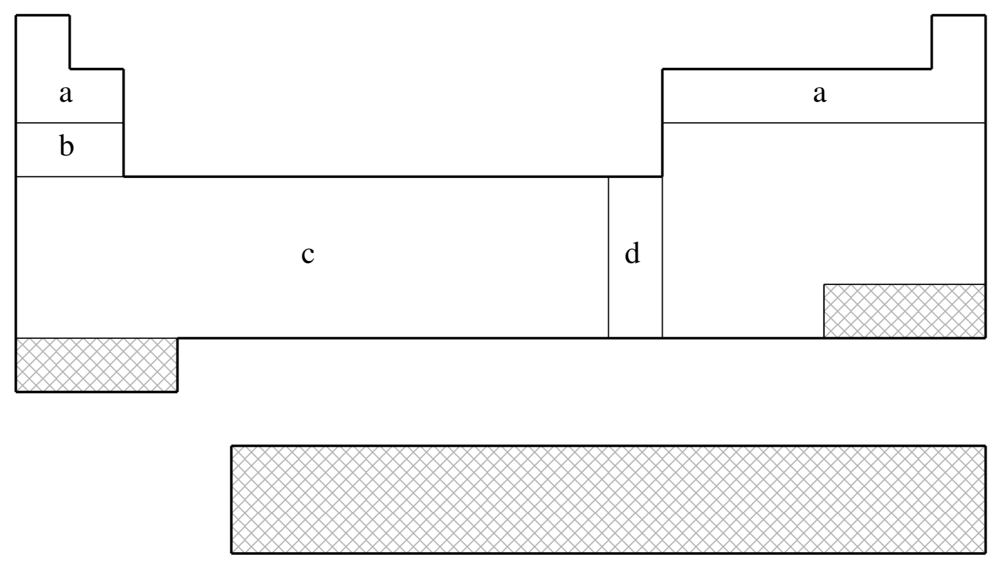
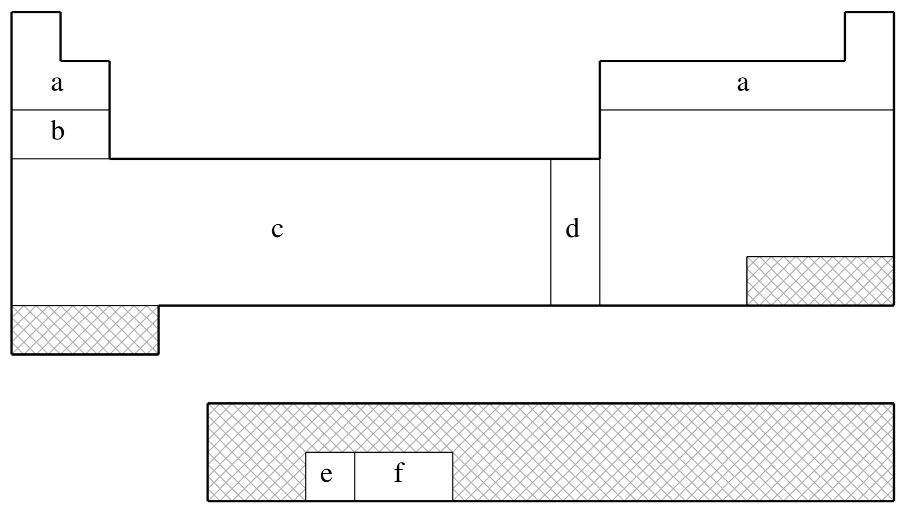
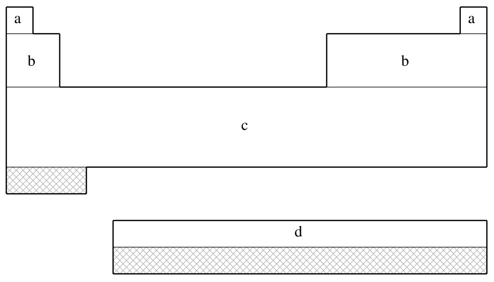
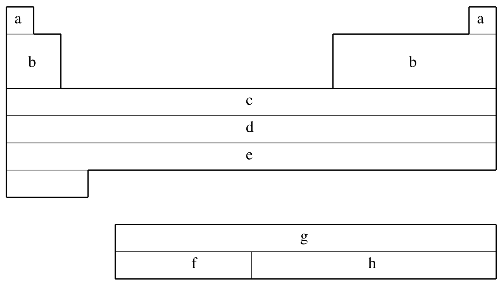
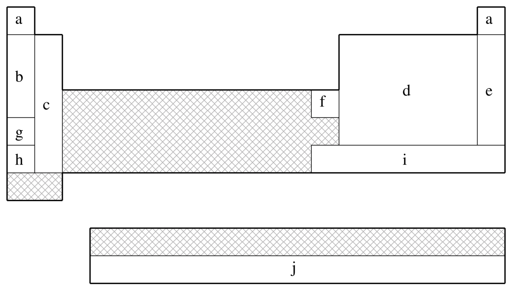
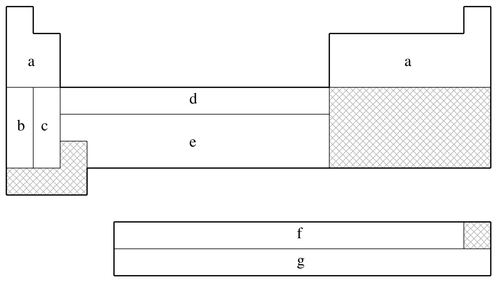

## 8.10.4 A Brief Guide to **Q-Chem**’s Built-In ECPs

(July 4, 2026)

## 8.10.4.1 Introduction

The remainder of this Chapter consists of a brief reference guide to **Q-Chem**’s
built-in ECPs. The ECPs vary in their complexity and their accuracy and the
purpose of the guide is to enable the user quickly and easily to decide which
ECP to use in a planned calculation.

The following information is provided for each ECP:

- The elements for which the ECP is available in **Q-Chem**. This is shown on
a schematic Periodic Table by shading all the elements that are
*not* supported.
- The literature reference for each element for which the ECP is available
in **Q-Chem**.
- The matching orbital basis set that **Q-Chem** will use for light (*i.e.*.
non-ECP atoms). For example, if the user requests SRSC ECPs—which
are defined only for atoms beyond argon—**Q-Chem** will use the
6-311G basis set for all atoms up to Ar.
- The core electrons that are replaced by the ECP. For example, in the
fit-LANL2DZ ECP for the Fe atom, the core is [Ne], indicating
that the $1s$, $2s$ and $2p$ electrons are removed.
- The maximum spherical harmonic projection operator that is used for each
element. This often, but not always, corresponds to the maximum orbital
angular momentum of the core electrons that have been replaced by the
ECP. For example, in the fit-LANL2DZ ECP for the Fe atom, the
maximum projector is of $P$-type.
- The number of valence basis functions of each angular momentum type that
are present in the matching orbital basis set. For example, in the
matching basis for the fit-LANL2DZ ECP for the Fe atom, there the
three $s$ shells, three $p$ shells and two $d$ shells. This basis is
therefore almost of triple-split valence quality.

## 8.10.4.2 The fit-HWMB ECP

*fit-HWMB is **not** available for shaded elements*

| (a) | No ECP; Pople STO-3G basis used |
| --- | --- |
| (b) | Wadt & Hay (Ref. [[1420]](../bib_references/bib.md#bib1479) ) |
| (c) | Hay & Wadt (Ref. [[535]](../bib_references/bib.md#bib549) ) |
| (d) | Hay & Wadt (Ref. [[534]](../bib_references/bib.md#bib548) ) |

| Element | Core | Max Projector | Valence |
| --- | --- | --- | --- |
| H–He | none | none | (1s) |
| Li–Ne | none | none | (2s,1p) |
| Na–Ar | [Ne] | $P$ | (1s,1p) |
| K–Ca | [Ne] | $P$ | (2s,1p) |
| Sc–Cu | [Ne] | $P$ | (2s,1p,1d) |
| Zn | [Ar] | $D$ | (1s,1p,1d) |
| Ga–Kr | [Ar]+3d | $D$ | (1s,1p) |
| Rb–Sr | [Ar]+3d | $D$ | (2s,1p) |
| Y–Ag | [Ar]+3d | $D$ | (2s,1p,1d) |
| Cd | [Kr] | $D$ | (1s,1p,1d) |
| In–Xe | [Kr]+4d | $D$ | (1s,1p) |
| Cs–Ba | [Kr]+4d | $D$ | (2s,1p) |
| La | [Kr]+4d | $D$ | (2s,1p,1d) |
| Hf–Au | [Kr]+4d+4f | $F$ | (2s,1p,1d) |
| Hg | [Xe]+4f | $F$ | (1s,1p,1d) |
| Tl–Bi | [Xe]+4f+5d | $F$ | (1s,1p) |

Table 8.10: Supported elements for the fit-HWMB ECP.

## 8.10.4.3 The fit-LANL2DZ ECP

*fit-LANL2DZ is **not** available for shaded elements*

| (a) | No ECP; Pople 6-31G basis used |
| --- | --- |
| (b) | Wadt & Hay (Ref. [[1420]](../bib_references/bib.md#bib1479) ) |
| (c) | Hay & Wadt (Ref. [[535]](../bib_references/bib.md#bib549) ) |
| (d) | Hay & Wadt (Ref. [[534]](../bib_references/bib.md#bib548) ) |
| (e) | Hay (Ref. [[536]](../bib_references/bib.md#bib547) ) |
| (f) | Hay & Martin (Ref. [[533]](../bib_references/bib.md#bib550) ) |

| Element | Core | Max Projector | Valence |
| --- | --- | --- | --- |
| H–He | none | none | (2s) |
| Li–Ne | none | none | (3s,2p) |
| Na–Ar | [Ne] | $P$ | (2s,2p) |
| K–Ca | [Ne] | $P$ | (3s,3p) |
| Sc–Cu | [Ne] | $P$ | (3s,3p,2d) |
| Zn | [Ar] | $D$ | (2s,2p,2d) |
| Ga–Kr | [Ar]+3d | $D$ | (2s,2p) |
| Rb–Sr | [Ar]+3d | $D$ | (3s,3p) |
| Y–Ag | [Ar]+3d | $D$ | (3s,3p,2d) |
| Cd | [Kr] | $D$ | (2s,2p,2d) |
| In–Xe | [Kr]+4d | $D$ | (2s,2p) |
| Cs–Ba | [Kr]+4d | $D$ | (3s,3p) |
| La | [Kr]+4d | $D$ | (3s,3p,2d) |
| Hf–Au | [Kr]+4d+4f | $F$ | (3s,3p,2d) |
| Hg | [Xe]+4f | $F$ | (2s,2p,2d) |
| Tl | [Xe]+4f+5d | $F$ | (2s,2p,2d) |
| Pb–Bi | [Xe]+4f+5d | $F$ | (2s,2p) |
| U–Pu | [Xe]+4f+5d | $F$ | (3s,3p,2d,2f) |

Table 8.11: Supported elements for the fit-LANL2DZ ECP.

Note that **Q-Chem** 4.2.2 and later versions also support the LANL2DZ-SV basis,
which employs SV basis functions (instead of 6-31G) on H, Li-Ne elements
(like some other quantum chemistry packages).

## 8.10.4.4 The fit-SBKJC ECP

*fit-SBKJC is **not** available for shaded elements*

| (a) | No ECP; Pople 3-21G basis used |
| --- | --- |
| (b) | Stevens, Basch, & M. Krauss (Ref. [[1311]](../bib_references/bib.md#bib1368) ) |
| (c) | Stevens, Krauss, Basch, & Jasien (Ref. [[1312]](../bib_references/bib.md#bib1369) ) |
| (d) | Cundari & Stevens (Ref. [[291]](../bib_references/bib.md#bib294) ) |

| Element | Core | Max Projector | Valence |
| --- | --- | --- | --- |
| H–He | none | none | (2s) |
| Li–Ne | [He] | $S$ | (2s,2p) |
| Na–Ar | [Ne] | $P$ | (2s,2p) |
| K–Ca | [Ar] | $P$ | (2s,2p) |
| Sc–Ga | [Ne] | $P$ | (4s,4p,3d) |
| Ge–Kr | [Ar]+3d | $D$ | (2s,2p) |
| Rb–Sr | [Kr] | $D$ | (2s,2p) |
| Y–In | [Ar]+3d | $D$ | (4s,4p,3d) |
| Sn–Xe | [Kr]+4d | $D$ | (2s,2p) |
| Cs–Ba | [Xe] | $D$ | (2s,2p) |
| La | [Kr]+4d | $F$ | (4s,4p,3d) |
| Ce–Lu | [Kr]+4d | $D$ | (4s,4p,1d,1f) |
| Hf–Tl | [Kr]+4d+4f | $F$ | (4s,4p,3d) |
| Pb–Rn | [Xe]+4f+5d | $F$ | (2s,2p) |

Table 8.12: Supported elements for the fit-SBKJC ECP.

## 8.10.4.5 The fit-CRENBS ECP

*fit-CRENBS is **not** available for shaded elements*

| (a) | No ECP; Pople STO-3G basis used |
| --- | --- |
| (b) | Hurley, Pacios, Christiansen, Ross, & Ermler (Ref. [[607]](../bib_references/bib.md#bib630) ) |
| (c) | LaJohn, Christiansen, Ross, Atashroo & Ermler (Ref. [[746]](../bib_references/bib.md#bib779) ) |
| (d) | Ross, Powers, Atashroo, Ermler, LaJohn & Christiansen (Ref. [[1184]](../bib_references/bib.md#bib1237) ) |
| (e) | Nash, Bursten, & Ermler (Ref. [[983]](../bib_references/bib.md#bib1025) ) |

| Element | Core | Max Projector | Valence |
| --- | --- | --- | --- |
| H–He | none | none | (1s) |
| Li–Ne | none | none | (2s,1p) |
| Na–Ar | none | none | (3s,2p) |
| K–Ca | none | none | (4s,3p) |
| Sc–Zn | [Ar] | $P$ | (1s,0p,1d) |
| Ga–Kr | [Ar]+3d | $D$ | (1s,1p) |
| Y–Cd | [Kr] | $D$ | (1s,1p,1d) |
| In–Xe | [Kr]+4d | $D$ | (1s,1p) |
| La | [Xe] | $D$ | (1s,1p,1d) |
| Hf–Hg | [Xe]+4f | $F$ | (1s,1p,1d) |
| Tl–Rn | [Xe]+4f+5d | $F$ | (1s,1p) |

Table 8.13: Supported elements for the fit-CRENBS ECP.

## 8.10.4.6 The fit-CRENBL ECP

| (a) | No ECP; Pople 6-311G basis used |
| --- | --- |
| (b) | Pacios & Christiansen (Ref. [[1033]](../bib_references/bib.md#bib1076) ) |
| (c) | Hurley, Pacios, Christiansen, Ross, & Ermler (Ref. [[607]](../bib_references/bib.md#bib630) ) |
| (d) | LaJohn, Christiansen, Ross, Atashroo, & Ermler (Ref. [[746]](../bib_references/bib.md#bib779) ) |
| (e) | Ross, Powers, Atashroo, Ermler, LaJohn, & Christiansen (Ref. [[1184]](../bib_references/bib.md#bib1237) ) |
| (f) | Ermler, Ross, & Christiansen (Ref. [[371]](../bib_references/bib.md#bib375) ) |
| (g) | Ross, Gayen, & Ermler (Ref. [[1183]](../bib_references/bib.md#bib1238) ) |
| (h) | Nash, Bursten, & Ermler (Ref. [[983]](../bib_references/bib.md#bib1025) ) |

| Element | Core | Max Projector | Valence |
| --- | --- | --- | --- |
| H–He | none | none | (3s) |
| Li–Ne | [He] | S | (4s,4p) |
| Na–Mg | [He] | S | (6s,4p) |
| Al–Ar | [Ne] | P | (4s,4p) |
| K–Ca | [Ne] | P | (5s,4p) |
| Sc–Zn | [Ne] | P | (7s,6p,6d) |
| Ga–Kr | [Ar] | P | (3s,3p,4d) |
| Rb–Sr | [Ar]+3d | D | (5s,5p) |
| Y–Cd | [Ar]+3d | D | (5s,5p,4d) |
| In–Xe | [Kr] | D | (3s,3p,4d) |
| Cs–La | [Kr]+4d | D | (5s,5p,4d) |
| Ce–Lu | [Xe] | D | (6s,6p,6d,6f) |
| Hf–Hg | [Kr]+4d+4f | F | (5s,5p,4d) |
| Tl–Rn | [Xe]+4f | F | (3s,3p,4d) |
| Fr–Ra | [Xe]+4f+5d | F | (5s,5p,4d) |
| Ac–Pu | [Xe]+4f+5d | F | (5s,5p,4d,4f) |
| Am–Lr | [Xe]+4f+5d | F | (0s,2p,6d,5f) |

Table 8.14: Supported elements for the fit-CRENBL ECP.

## 8.10.4.7 The SRLC ECP

*SRLC is **not** available for shaded elements*

| (a) | No ECP; Pople 6-31G basis used |
| --- | --- |
| (b) | Fuentealba, Preuss, Stoll, & von Szentpály (Ref. [[414]](../bib_references/bib.md#bib422) ) |
| (c) | Fuentealba, von Szentpály, Preuss, & Stoll (Ref. [[416]](../bib_references/bib.md#bib424) ) |
| (d) | Bergner, Dolg, Küchle, Stoll, & Preuss (Ref. [[113]](../bib_references/bib.md#bib100) ) |
| (e) | Nicklass, Dolg, Stoll, & Preuss, (Ref. [[992]](../bib_references/bib.md#bib1034) ) |
| (f) | Schautz, Flad, & Dolg (Ref. [[1205]](../bib_references/bib.md#bib1259) ) |
| (g) | Fuentealba, Stoll, von Szentpály, Schwerdtfeger, & Preuss (Ref. [[415]](../bib_references/bib.md#bib423) ) |
| (h) | von Szentpály, Fuentealba, Preuss, & Stoll (Ref. [[1409]](../bib_references/bib.md#bib1469) ) |
| (i) | Küchle, Dolg, Stoll, & Preuss (Ref. [[732]](../bib_references/bib.md#bib765) ) |
| (j) | Küchle (Ref. ) |

| Element | Core | Max Projector | Valence |
| --- | --- | --- | --- |
| H–He | none | none | (2s) |
| Li–Be | [He] | $P$ | (2s,2p) |
| B–N | [He] | $D$ | (2s,2p) |
| O–F | [He] | $D$ | (2s,3p) |
| Ne | [He] | $D$ | (4s,4p,3d,1f) |
| Na–P | [Ne] | $D$ | (2s,2p) |
| S–Cl | [Ne] | $D$ | (2s,3p) |
| Ar | [Ne] | $F$ | (4s,4p,3d,1f) |
| K–Ca | [Ar] | $D$ | (2s,2p) |
| Zn | [Ar]+3d | $D$ | (3s,2p) |
| Ga–As | [Ar]+3d | $F$ | (2s,2p) |
| Se–Br | [Ar]+3d | $F$ | (2s,3p) |
| Kr | [Ar]+3d | $G$ | (4s,4p,3d,1f) |
| Rb–Sr | [Kr] | $D$ | (2s,2p) |
| In–Sb | [Kr]+4d | $F$ | (2s,2p) |
| Te–I | [Kr]+4d | $F$ | (2s,3p) |
| Xe | [Kr]+4d | $G$ | (4s,4p,3d,1f) |
| Cs–Ba | [Xe] | $D$ | (2s,2p) |
| Hg–Bi | [Xe]+4f+5d | $G$ | (2s,2p,1d) |
| Po–At | [Xe]+4f+5d | $G$ | (2s,3p,1d) |
| Rn | [Xe]+4f+5d | $G$ | (2s,2p,1d) |
| Ac–Lr | [Xe]+4f+5d | $G$ | (5s,5p,4d,3f,2g) |

Table 8.15: Supported elements for the SRLC ECP.

## 8.10.4.8 The SRSC ECP

*SRSC is **not** available for shaded elements*

| (a) | No ECP; Pople 6-311G basis used |
| --- | --- |
| (b) | Leininger, Nicklass, Küchle, Stoll, Dolg, & Bergner (Ref. [[800]](../bib_references/bib.md#bib834) ) |
| (c) | Kaupp, Schleyer, Stoll, & Preuss (Ref. [[673]](../bib_references/bib.md#bib697) ) |
| (d) | Dolg, Wedig, Stoll, & Preuss (Ref. [[349]](../bib_references/bib.md#bib351) ) |
| (e) | Andrae, Häußermann, Dolg, Stoll, & Preuss (Ref. [[47]](../bib_references/bib.md#bib30) ) |
| (f) | Dolg, Stoll, & Preuss (Ref. [[347]](../bib_references/bib.md#bib352) ) |
| (g) | Küchle, Dolg, Stoll, & Preuss (Ref. [[733]](../bib_references/bib.md#bib767) ) |
| (h) | Dolg, Stoll, Preuss, & Pitzer (Ref. [[348]](../bib_references/bib.md#bib353) ) |

| Element | Core | Max Projector | Valence |
| --- | --- | --- | --- |
| H–He | none | none | (3s) |
| Li–Ne | none | none | (4s,3p,1d) |
| Na–Ar | none | none | (6s,5p,1d) |
| K | [Ne] | $F$ | (5s,4p) |
| Ca | [Ne] | $F$ | (4s,4p,2d) |
| Sc–Zn | [Ne] | $D$ | (6s,5p,3d) |
| Rb | [Ar]+3d | $F$ | (5s,4p) |
| Sr | [Ar]+3d | $F$ | (4s,4p,2d) |
| Y–Cd | [Ar]+3d | $F$ | (6s,5p,3d) |
| Cs | [Kr]+4d | $F$ | (5s,4p) |
| Ba | [Kr]+4d | $F$ | (3s,3p,2d,1f) |
| Ce–Yb | [Ar]+3d | $G$ | (5s,5p,4d,3f) |
| Hf–Pt | [Kr]+4d+4f | $G$ | (6s,5p,3d) |
| Au | [Kr]+4d+4f | $F$ | (7s,3p,4d) |
| Hg | [Kr]+4d+4f | $G$ | (6s,6p,4d) |
| Ac–Lr | [Kr]+4d+4f | $G$ | (8s,7p,6d,4f) |

Table 8.16: Supported elements for the SRSC ECP.

## 8.10.4.9 The Karlsruhe “def2” ECPs

For elements Rb–Rn, all the Karlsruhe “def2” basis sets are paired with a
common set of ECPs.[[1438]](../bib_references/bib.md#bib1504)
 It is briefly summarized in the table
below (the number of valence basis functions depend on the basis set in use,
so it is not presented):

| Element | Core | Max Projector |
| --- | --- | --- |
| H–Kr | none | none |
| Rb–Xe | [Ar]+3d | $D$ |
| Cs–La | [Kr]+4d | $D$ |
| Hf–Rn | [Kr]+4d+4f | $D$ |

Table 8.17: Supported elements for the def2 ECP.
