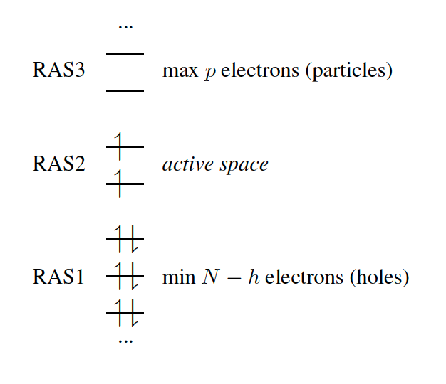

## 7.11.2 受限活性空间（RAS）方案

（2026 年 7 月 4 日）

在 RAS 形式体系中，将轨道空间划分为三个子空间，分别称为 RAS1、RAS2 和 RAS3（图 [7.3](#fig:RAS)）。RAS-CI 态由每个子空间中的轨道数目及所施加的限制来定义。

*图 7.3：采用 ROHF 三重态参考的 RAS-CI 轨道子空间。*

单参考 RAS-CI 电子波函数通过对参考行列式 $|\phi^{\text{(0)}}\rangle$ 施加自旋翻转（spin-flipping）算符或激发算符 $\hat{R}$ 而得到。

$$
\left|{\Psi}^{\text{RAS}}\right>=\hat{R}\left|\phi^{\text{(0)}}\right> \tag{7.163}
$$

$\hat{R}$ 算符必须遵守在子空间 RAS1、RAS2 和 RAS3 中所施加的限制，并可分解为

$$
\hat{R}=\hat{r}^{\text{RAS2}}+\hat{r}^{h}+\hat{r}^{p}+\hat{r}^{hp}+\hat{r}^{2h}+\hat{r}^{2p}+\cdots\;. \tag{7.164}
$$

其中，$\hat{r}^{\text{RAS2}}$ 包含 RAS2 空间内所有可能的电子提升（promotion），*即*一个约化的全组态相互作用（reduced full CI）；其余各项则生成具有不同空穴（hole，$h$）数和粒子（particle，$p$）数的组态。
