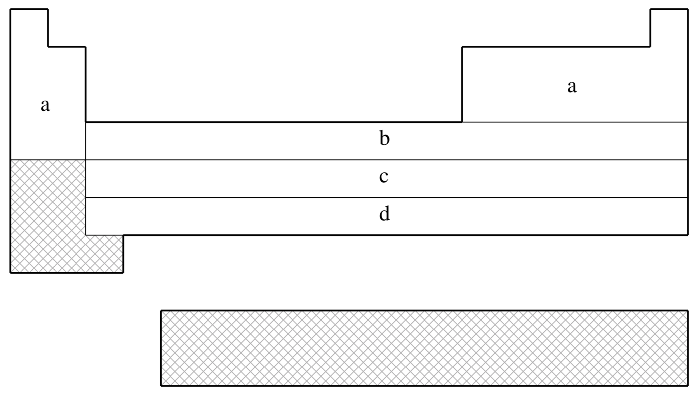

## 8.10.4 **Q-Chem** 内置有效核势（ECP）简明指南

(July 4, 2026)

## 8.10.4.1 引言

本章余下部分是关于 **Q-Chem** 内置有效核势（Effective Core Potential, ECP）的简明参考指南。各 ECP 在复杂程度和精度上各有差异，本指南旨在帮助用户快速、便捷地为计划中的计算选定合适的 ECP。

针对每种 ECP，提供以下信息：

- •

该 ECP 在 **Q-Chem** 中可用于哪些元素。这些信息以示意图形式的元素周期表呈现，其中*不*支持的元素以阴影标出。
- •

对于 **Q-Chem** 中该 ECP 所覆盖的每个元素，给出相应的文献出处。
- •

**Q-Chem** 对轻元素（*即*不采用 ECP 的原子）所使用的匹配轨道基组（Basis Set）。例如，若用户选用 SRSC ECP——其仅定义于氩之后的原子——则 **Q-Chem** 会对直至 Ar 的所有原子使用 6-311G 基组。
- •

被 ECP 取代的内层（core）电子。例如，fit-LANL2DZ ECP 中 Fe 原子的核为 [Ne]，表示移除了 $1s$、$2s$ 和 $2p$ 电子。
- •

每个元素所使用的最大球谐投影算符（spherical harmonic projection operator）。该投影算符通常（但并非总是）与被 ECP 取代的内层电子的最大轨道角动量相对应。例如，fit-LANL2DZ ECP 中 Fe 原子的最大投影算符为 $P$ 型。
- •

匹配轨道基组中各角动量类型的价基函数数目。例如，fit-LANL2DZ ECP 中 Fe 原子的匹配基组包含三个 $s$ 壳层、三个 $p$ 壳层和两个 $d$ 壳层，因此该基组几乎达到三重分裂价层（triple-split valence）品质。

## 8.10.4.2 fit-HWMB ECP

*fit-HWMB 对阴影元素**不可用***

| (a) | 不使用 ECP；采用 Pople STO-3G 基组 |
| --- | --- |
| (b) | Wadt 与 Hay（参考文献 [[1420]](../bib_references/bib.md#bib1479)） |
| (c) | Hay 与 Wadt（参考文献 [[535]](../bib_references/bib.md#bib549)） |
| (d) | Hay 与 Wadt（参考文献 [[534]](../bib_references/bib.md#bib548)） |

| 元素 | 内核 | 最大投影算符 | 价层 |
| --- | --- | --- | --- |
| H–He | 无 | 无 | (1s) |
| Li–Ne | 无 | 无 | (2s,1p) |
| Na–Ar | [Ne] | $P$ | (1s,1p) |
| K–Ca | [Ne] | $P$ | (2s,1p) |
| Sc–Cu | [Ne] | $P$ | (2s,1p,1d) |
| Zn | [Ar] | $D$ | (1s,1p,1d) |
| Ga–Kr | [Ar]+3d | $D$ | (1s,1p) |
| Rb–Sr | [Ar]+3d | $D$ | (2s,1p) |
| Y–Ag | [Ar]+3d | $D$ | (2s,1p,1d) |
| Cd | [Kr] | $D$ | (1s,1p,1d) |
| In–Xe | [Kr]+4d | $D$ | (1s,1p) |
| Cs–Ba | [Kr]+4d | $D$ | (2s,1p) |
| La | [Kr]+4d | $D$ | (2s,1p,1d) |
| Hf–Au | [Kr]+4d+4f | $F$ | (2s,1p,1d) |
| Hg | [Xe]+4f | $F$ | (1s,1p,1d) |
| Tl–Bi | [Xe]+4f+5d | $F$ | (1s,1p) |

表 8.10：fit-HWMB ECP 支持的元素。

## 8.10.4.3 fit-LANL2DZ ECP

*fit-LANL2DZ 对阴影元素**不可用***

| (a) | 不使用 ECP；采用 Pople 6-31G 基组 |
| --- | --- |
| (b) | Wadt 与 Hay（参考文献 [[1420]](../bib_references/bib.md#bib1479)） |
| (c) | Hay 与 Wadt（参考文献 [[535]](../bib_references/bib.md#bib549)） |
| (d) | Hay 与 Wadt（参考文献 [[534]](../bib_references/bib.md#bib548)） |
| (e) | Hay（参考文献 [[536]](../bib_references/bib.md#bib547)） |
| (f) | Hay 与 Martin（参考文献 [[533]](../bib_references/bib.md#bib550)） |

| 元素 | 内核 | 最大投影算符 | 价层 |
| --- | --- | --- | --- |
| H–He | 无 | 无 | (2s) |
| Li–Ne | 无 | 无 | (3s,2p) |
| Na–Ar | [Ne] | $P$ | (2s,2p) |
| K–Ca | [Ne] | $P$ | (3s,3p) |
| Sc–Cu | [Ne] | $P$ | (3s,3p,2d) |
| Zn | [Ar] | $D$ | (2s,2p,2d) |
| Ga–Kr | [Ar]+3d | $D$ | (2s,2p) |
| Rb–Sr | [Ar]+3d | $D$ | (3s,3p) |
| Y–Ag | [Ar]+3d | $D$ | (3s,3p,2d) |
| Cd | [Kr] | $D$ | (2s,2p,2d) |
| In–Xe | [Kr]+4d | $D$ | (2s,2p) |
| Cs–Ba | [Kr]+4d | $D$ | (3s,3p) |
| La | [Kr]+4d | $D$ | (3s,3p,2d) |
| Hf–Au | [Kr]+4d+4f | $F$ | (3s,3p,2d) |
| Hg | [Xe]+4f | $F$ | (2s,2p,2d) |
| Tl | [Xe]+4f+5d | $F$ | (2s,2p,2d) |
| Pb–Bi | [Xe]+4f+5d | $F$ | (2s,2p) |
| U–Pu | [Xe]+4f+5d | $F$ | (3s,3p,2d,2f) |

表 8.11：fit-LANL2DZ ECP 支持的元素。

请注意，**Q-Chem** 4.2.2 及更高版本还支持 LANL2DZ-SV 基组，该基组对 H、Li–Ne 元素采用 SV 基函数（而非 6-31G），这与其他一些量子化学程序的作法相同。

## 8.10.4.4 fit-SBKJC ECP

*fit-SBKJC 对阴影元素**不可用***

| (a) | 不使用 ECP；采用 Pople 3-21G 基组 |
| --- | --- |
| (b) | Stevens、Basch 与 M. Krauss（参考文献 [[1311]](../bib_references/bib.md#bib1368)） |
| (c) | Stevens、Krauss、Basch 与 Jasien（参考文献 [[1312]](../bib_references/bib.md#bib1369)） |
| (d) | Cundari 与 Stevens（参考文献 [[291]](../bib_references/bib.md#bib294)） |

| 元素 | 内核 | 最大投影算符 | 价层 |
| --- | --- | --- | --- |
| H–He | 无 | 无 | (2s) |
| Li–Ne | [He] | $S$ | (2s,2p) |
| Na–Ar | [Ne] | $P$ | (2s,2p) |
| K–Ca | [Ar] | $P$ | (2s,2p) |
| Sc–Ga | [Ne] | $P$ | (4s,4p,3d) |
| Ge–Kr | [Ar]+3d | $D$ | (2s,2p) |
| Rb–Sr | [Kr] | $D$ | (2s,2p) |
| Y–In | [Ar]+3d | $D$ | (4s,4p,3d) |
| Sn–Xe | [Kr]+4d | $D$ | (2s,2p) |
| Cs–Ba | [Xe] | $D$ | (2s,2p) |
| La | [Kr]+4d | $F$ | (4s,4p,3d) |
| Ce–Lu | [Kr]+4d | $D$ | (4s,4p,1d,1f) |
| Hf–Tl | [Kr]+4d+4f | $F$ | (4s,4p,3d) |
| Pb–Rn | [Xe]+4f+5d | $F$ | (2s,2p) |

表 8.12：fit-SBKJC ECP 支持的元素。

## 8.10.4.5 fit-CRENBS ECP

*fit-CRENBS 对阴影元素**不可用***

| (a) | 不使用 ECP；采用 Pople STO-3G 基组 |
| --- | --- |
| (b) | Hurley、Pacios、Christiansen、Ross 与 Ermler（参考文献 [[607]](../bib_references/bib.md#bib630)） |
| (c) | LaJohn、Christiansen、Ross、Atashroo 与 Ermler（参考文献 [[746]](../bib_references/bib.md#bib779)） |
| (d) | Ross、Powers、Atashroo、Ermler、LaJohn 与 Christiansen（参考文献 [[1184]](../bib_references/bib.md#bib1237)） |
| (e) | Nash、Bursten 与 Ermler（参考文献 [[983]](../bib_references/bib.md#bib1025)） |

| 元素 | 内核 | 最大投影算符 | 价层 |
| --- | --- | --- | --- |
| H–He | 无 | 无 | (1s) |
| Li–Ne | 无 | 无 | (2s,1p) |
| Na–Ar | 无 | 无 | (3s,2p) |
| K–Ca | 无 | 无 | (4s,3p) |
| Sc–Zn | [Ar] | $P$ | (1s,0p,1d) |
| Ga–Kr | [Ar]+3d | $D$ | (1s,1p) |
| Y–Cd | [Kr] | $D$ | (1s,1p,1d) |
| In–Xe | [Kr]+4d | $D$ | (1s,1p) |
| La | [Xe] | $D$ | (1s,1p,1d) |
| Hf–Hg | [Xe]+4f | $F$ | (1s,1p,1d) |
| Tl–Rn | [Xe]+4f+5d | $F$ | (1s,1p) |

表 8.13：fit-CRENBS ECP 支持的元素。

## 8.10.4.6 fit-CRENBL ECP

| (a) | 不使用 ECP；采用 Pople 6-311G 基组 |
| --- | --- |
| (b) | Pacios 与 Christiansen（参考文献 [[1033]](../bib_references/bib.md#bib1076)） |
| (c) | Hurley、Pacios、Christiansen、Ross 与 Ermler（参考文献 [[607]](../bib_references/bib.md#bib630)） |
| (d) | LaJohn、Christiansen、Ross、Atashroo 与 Ermler（参考文献 [[746]](../bib_references/bib.md#bib779)） |
| (e) | Ross、Powers、Atashroo、Ermler、LaJohn 与 Christiansen（参考文献 [[1184]](../bib_references/bib.md#bib1237)） |
| (f) | Ermler、Ross 与 Christiansen（参考文献 [[371]](../bib_references/bib.md#bib375)） |
| (g) | Ross、Gayen 与 Ermler（参考文献 [[1183]](../bib_references/bib.md#bib1238)） |
| (h) | Nash、Bursten 与 Ermler（参考文献 [[983]](../bib_references/bib.md#bib1025)） |

| 元素 | 内核 | 最大投影算符 | 价层 |
| --- | --- | --- | --- |
| H–He | 无 | 无 | (3s) |
| Li–Ne | [He] | S | (4s,4p) |
| Na–Mg | [He] | S | (6s,4p) |
| Al–Ar | [Ne] | P | (4s,4p) |
| K–Ca | [Ne] | P | (5s,4p) |
| Sc–Zn | [Ne] | P | (7s,6p,6d) |
| Ga–Kr | [Ar] | P | (3s,3p,4d) |
| Rb–Sr | [Ar]+3d | D | (5s,5p) |
| Y–Cd | [Ar]+3d | D | (5s,5p,4d) |
| In–Xe | [Kr] | D | (3s,3p,4d) |
| Cs–La | [Kr]+4d | D | (5s,5p,4d) |
| Ce–Lu | [Xe] | D | (6s,6p,6d,6f) |
| Hf–Hg | [Kr]+4d+4f | F | (5s,5p,4d) |
| Tl–Rn | [Xe]+4f | F | (3s,3p,4d) |
| Fr–Ra | [Xe]+4f+5d | F | (5s,5p,4d) |
| Ac–Pu | [Xe]+4f+5d | F | (5s,5p,4d,4f) |
| Am–Lr | [Xe]+4f+5d | F | (0s,2p,6d,5f) |

表 8.14：fit-CRENBL ECP 支持的元素。

## 8.10.4.7 SRLC ECP

*SRLC 对阴影元素**不可用***

| (a) | 不使用 ECP；采用 Pople 6-31G 基组 |
| --- | --- |
| (b) | Fuentealba、Preuss、Stoll 与 von Szentpály（参考文献 [[414]](../bib_references/bib.md#bib422)） |
| (c) | Fuentealba、von Szentpály、Preuss 与 Stoll（参考文献 [[416]](../bib_references/bib.md#bib424)） |
| (d) | Bergner、Dolg、Küchle、Stoll 与 Preuss（参考文献 [[113]](../bib_references/bib.md#bib100)） |
| (e) | Nicklass、Dolg、Stoll 与 Preuss（参考文献 [[992]](../bib_references/bib.md#bib1034)） |
| (f) | Schautz、Flad 与 Dolg（参考文献 [[1205]](../bib_references/bib.md#bib1259)） |
| (g) | Fuentealba、Stoll、von Szentpály、Schwerdtfeger 与 Preuss（参考文献 [[415]](../bib_references/bib.md#bib423)） |
| (h) | von Szentpály、Fuentealba、Preuss 与 Stoll（参考文献 [[1409]](../bib_references/bib.md#bib1469)） |
| (i) | Küchle、Dolg、Stoll 与 Preuss（参考文献 [[732]](../bib_references/bib.md#bib765)） |
| (j) | Küchle（参考文献 ） |

| 元素 | 内核 | 最大投影算符 | 价层 |
| --- | --- | --- | --- |
| H–He | 无 | 无 | (2s) |
| Li–Be | [He] | $P$ | (2s,2p) |
| B–N | [He] | $D$ | (2s,2p) |
| O–F | [He] | $D$ | (2s,3p) |
| Ne | [He] | $D$ | (4s,4p,3d,1f) |
| Na–P | [Ne] | $D$ | (2s,2p) |
| S–Cl | [Ne] | $D$ | (2s,3p) |
| Ar | [Ne] | $F$ | (4s,4p,3d,1f) |
| K–Ca | [Ar] | $D$ | (2s,2p) |
| Zn | [Ar]+3d | $D$ | (3s,2p) |
| Ga–As | [Ar]+3d | $F$ | (2s,2p) |
| Se–Br | [Ar]+3d | $F$ | (2s,3p) |
| Kr | [Ar]+3d | $G$ | (4s,4p,3d,1f) |
| Rb–Sr | [Kr] | $D$ | (2s,2p) |
| In–Sb | [Kr]+4d | $F$ | (2s,2p) |
| Te–I | [Kr]+4d | $F$ | (2s,3p) |
| Xe | [Kr]+4d | $G$ | (4s,4p,3d,1f) |
| Cs–Ba | [Xe] | $D$ | (2s,2p) |
| Hg–Bi | [Xe]+4f+5d | $G$ | (2s,2p,1d) |
| Po–At | [Xe]+4f+5d | $G$ | (2s,3p,1d) |
| Rn | [Xe]+4f+5d | $G$ | (2s,2p,1d) |
| Ac–Lr | [Xe]+4f+5d | $G$ | (5s,5p,4d,3f,2g) |

表 8.15：SRLC ECP 支持的元素。

## 8.10.4.8 SRSC ECP

*SRSC 对阴影元素**不可用***

| (a) | 不使用 ECP；采用 Pople 6-311G 基组 |
| --- | --- |
| (b) | Leininger、Nicklass、Küchle、Stoll、Dolg 与 Bergner（参考文献 [[800]](../bib_references/bib.md#bib834)） |
| (c) | Kaupp、Schleyer、Stoll 与 Preuss（参考文献 [[673]](../bib_references/bib.md#bib697)） |
| (d) | Dolg、Wedig、Stoll 与 Preuss（参考文献 [[349]](../bib_references/bib.md#bib351)） |
| (e) | Andrae、Häußermann、Dolg、Stoll 与 Preuss（参考文献 [[47]](../bib_references/bib.md#bib30)） |
| (f) | Dolg、Stoll 与 Preuss（参考文献 [[347]](../bib_references/bib.md#bib352)） |
| (g) | Küchle、Dolg、Stoll 与 Preuss（参考文献 [[733]](../bib_references/bib.md#bib767)） |
| (h) | Dolg、Stoll、Preuss 与 Pitzer（参考文献 [[348]](../bib_references/bib.md#bib353)） |

| 元素 | 内核 | 最大投影算符 | 价层 |
| --- | --- | --- | --- |
| H–He | 无 | 无 | (3s) |
| Li–Ne | 无 | 无 | (4s,3p,1d) |
| Na–Ar | 无 | 无 | (6s,5p,1d) |
| K | [Ne] | $F$ | (5s,4p) |
| Ca | [Ne] | $F$ | (4s,4p,2d) |
| Sc–Zn | [Ne] | $D$ | (6s,5p,3d) |
| Rb | [Ar]+3d | $F$ | (5s,4p) |
| Sr | [Ar]+3d | $F$ | (4s,4p,2d) |
| Y–Cd | [Ar]+3d | $F$ | (6s,5p,3d) |
| Cs | [Kr]+4d | $F$ | (5s,4p) |
| Ba | [Kr]+4d | $F$ | (3s,3p,2d,1f) |
| Ce–Yb | [Ar]+3d | $G$ | (5s,5p,4d,3f) |
| Hf–Pt | [Kr]+4d+4f | $G$ | (6s,5p,3d) |
| Au | [Kr]+4d+4f | $F$ | (7s,3p,4d) |
| Hg | [Kr]+4d+4f | $G$ | (6s,6p,4d) |
| Ac–Lr | [Kr]+4d+4f | $G$ | (8s,7p,6d,4f) |

表 8.16：SRSC ECP 支持的元素。

## 8.10.4.9 Karlsruhe “def2” 系列 ECP

对于 Rb–Rn 元素，所有 Karlsruhe “def2” 基组均配用同一套 ECP。[[1438]](../bib_references/bib.md#bib1504)
 下表对其作了简要汇总（价基函数数目取决于所用基组，因此不予列出）：

| 元素 | 内核 | 最大投影算符 |
| --- | --- | --- |
| H–Kr | 无 | 无 |
| Rb–Xe | [Ar]+3d | $D$ |
| Cs–La | [Kr]+4d | $D$ |
| Hf–Rn | [Kr]+4d+4f | $D$ |

表 8.17：def2 ECP 支持的元素。
