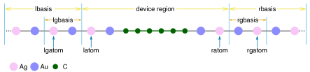
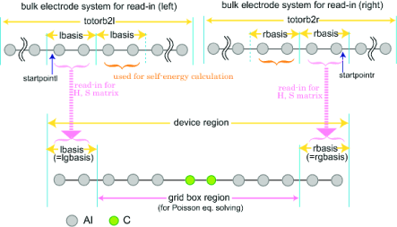

## 13.4.1 概述

(July 4, 2026)

分子结的电导及电流-电压关系可以通过 Landauer 方法或非平衡格林函数（Non-Equilibrium Green's Function, NEGF）理论层次来计算。在这两种情况下，均采用在选定电子结构层次上的格林函数形式体系。进一步的介绍见参考文献 。

在分子结中，电流-电压曲线取决于电子透射函数，该函数可使用 Dunietz 课题组（肯特州立大学）开发的量子输运代码进行计算。无散射方法（Landauer）提供零偏压极限，非平衡方法（NEGF）则通过对受偏压影响的电子密度进行迭代求解，提供与电压相关的透射函数。

通过设置 *$rem* 变量 TRANS_ENABLE 来调用该量子输运功能。

### `TRANS_ENABLE`

> **用于调用分子输运代码。输入段：$REM**
>
> * **类型**：`INTEGER`
> * **默认值**：`0`
> * **选项**：
>     * 0
>     * 不进行电子输运计算。
>     * 1
>     * Landauer；零偏压极限。
>     * 3
>     * 零偏压下的自洽格林函数计算
>     * （零偏压 NEGF，通常用于为偏压依赖的 NEGF 计算做准备）。
>     * 4
>     * 完整 NEGF。
>     * -1
>     * 打印生成体相模型数据文件所需的矩阵。
> * **建议**：值 3 或 4 必须在 $rem 段中与 SCF_ALGORITHM = NEGF 一起设置，并应设置 POINT_GROUP_SYMMETRY = FALSE 以固定原子坐标。对于 NEGF 计算，输运轴假定为沿 X 轴方向，偏压电势沿该轴降落。

除 **Q-Chem** 输出文件中包含的信息外，还会生成以下文件：

- `transmission.txt`（所请求能量窗口内的透射函数）
- `TDOS.txt`（总态密度）
- `current.txt`（仅针对 Landauer 层次的 I-V 图）
- `IV-NEGF-all.txt`（通过 NEGF 方法获得的 I-V 图）

输运标志可用于打印结或体相模型的数据矩阵，以供后续输运计算使用：

- `FAmat.dat`（用于后续计算和分析的哈密顿矩阵）
- `Smat.dat`（用于后续计算和分析的重叠矩阵）
- `DAmat.dat`（用于后续计算和分析的密度矩阵 [仅用于 NEGF]）

（在打印体相信息的情况下，需要按照下文的说明对文件进行重命名。）

在非限制自旋的情况下，输出文件名后附加 A[B] 以指示自旋态。
（*例如* `transmissionA.txt` 和 `transmissionB.txt`）。
我们注意到，在闭壳层自旋限制情况下，`transmission.txt` 对应于 $\alpha$ 自旋，其中由于自旋对称性，总透射值是文件中包含的值的两倍。

Landauer 层次生成一组输出文件。NEGF 计算为不同偏压提供目录，其中目录
`Vbias1`、`Vbias2`、$\cdots$（目录名中的数字用于索引偏压电压）包含相应偏压下的输出文件。

T-Chem 程序在设置输运计算方面允许高度灵活性，因此需要设置多个参数。相应地，实际的分子结模型被划分为代表电极自能（Self-Energy, SE）和中心桥接区域的各域，以及计算 SEs 的过程。

该设置在输入文件的两个输运专用段中进行处理：

- *$trans_model*（分子结区域）
- *$trans_method*（设置各种输运标志，包括 SE 评估细节、NEGF 积分、网格参数，以及费米能量和偏压等各种输入参数）



*图 13.1：用于 Landauer 计算的分子结不同区域示意图。*



*图 13.2：用于 NEGF 计算的分子结不同区域示意图。*

*$trans_model* 段对分子模型进行划分，将原子基函数分配到不同区域。没有默认值。不同区域的设置如
图 [13.1](#mj-lan) 和图 [13.2](#mj-negf) 所示，分别对应 Landauer 和 NEGF 层次。

*$trans_model* 段中的参数可以通过原子编号或基函数来提供。
!!! note "注意"
    只需要提供其中一组编号。
    基于 trans_latom 等的分配具有优先权。


- **trans_latom**：INTEGER，原子索引，表示中心/桥接区域的起始位置（结区域中的第一个原子）。
- **trans_ratom**：INTEGER，原子索引，表示中心/桥接区域的结束位置（结区域中的最后一个原子）。
- **trans_lgatom**：INTEGER，原子索引，表示左电极重复单元的起始位置。
- **trans_rgatom**：INTEGER，原子索引，表示右电极重复单元的结束位置。

在 **trans_lgatom**、**trans_lgatom**+1、..、**trans_latom**-1 范围内的原子定义左电极的重复单元（右电极类似）。

- **trans_lbasis**：INTEGER，出现在器件区域左侧的基函数数目（中心区域内第一个原子轨道（AO）的索引）。
- **trans_rbasis**：INTEGER，出现在器件区域（右电极）右侧的基函数数目（基函数总数减去此数等于器件区域内的最后一个 AO）。
- **trans_lgbasis**：INTEGER，左电极重复单元的基函数数目。
- **trans_rgbasis**：INTEGER，右电极重复单元的基函数数目。

对于 NEGF 计算，**trans_lbasis** 和 **trans_lgbasis** 必须相同，如图 [13.2](#mj-negf) 所示
（**trans_rbasis** 和 **trans_rgbasis** 同理）。NEGF 计算需要预计算的体相数据，而 Landauer 方法可以选择使用此类预计算数据。

图 [13.1](#mj-lan) 中的示例共包含 18 个原子，其中 Au 和 Ag 基组每个原子各包含 22 个基函数。重复单元包含一对 Au 和 Ag 原子。因此参数应如下给出（仅前两列是必需的，其余列用于说明）：

| trans_lbasis | 88 | 代表左电极区域的函数数（$2\times 22$ 为 Ag + $2\times 22$ 为 Au） |
| --- | --- | --- |
| trans_rbasis | 88 | 代表右电极的函数数（$2\times 22$ 为 Ag + $2\times 22$ 为 Au） |
| trans_lgbasis | 44 | 左电极重复单元的大小（22 为 Ag + 22 为 Au） |
| trans_rgbasis | 44 | 右电极重复单元的大小（22 为 Ag + 22 为 Au） |

或者，该段也可以基于对应于 *$molecule* 段中原子位置的原子编号来设置：

| trans_lgatom | 3 | 第三个原子用于定义左电极的重复单元 |
| --- | --- | --- |
| trans_latom | 5 | 第五个原子是结的第一个原子 |
| trans_ratom | 14 | 第十四个原子是结的最后一个原子 |
| trans_rgatom | 16 | 第十六个原子用于定义右电极的重复单元 |

在此示例中，我们对左右电极使用了相同的重复单元；此对称性并*不*是必需的。

警告：在两个示例中都使用了原子线：Landauer 情况下使用 Au/Ag 线，NEGF 示例中使用 Al 线。这里 Au/Ag 对或单个 Al 原子代表一个体相重复单元，在更详细的模型中，该单元内的原子必须在所有单元中以相同的顺序引入。所有体相层必须按顺序（"从左到右"）排列，包括被指定为包含在中心区域内的第一个和最后一个体相单元。

!!! note "注意"
    *$molecule* 段中原子的顺序很重要，并假定以下顺序：
    重复单元（左）- 分子结 - 重复单元（右）


原子首先由左电极中最左侧重复单元给出，然后依次给出下一个重复单元，直至表面单元。接下来给出桥接原子，然后是右表面单元和右电极区域。右电极区域从表面层开始，到体相中最远的层结束。每个电极重复单元内原子的顺序必须保持一致。桥接区域（不包括电极重复单元原子）内原子的顺序是任意的。

也就是说，分子段中原子的顺序必须遵循：

1. 最左侧重复单元的原子
2. 下一个（些）重复单元的原子（如果存在）
3. 左表面单元器件的原子
4. 桥接原子
5. 右表面单元的原子
6. 右电极下一个（些）单元的原子（如果存在）
7. 最右侧重复单元的原子

T-Chem 允许在确定电极模型的不同方面具有完全灵活性。因此，区域的错误设置无法被程序捕获，可能导致非物理的透射函数（*例如* 很大的甚至负值）。此类错误可能发生在团簇模型被（错误地）划分在某原子的轨道空间内部时。区域应定义在重复单元之间。每个重复单元内的原子必须始终以相同的内部顺序给出，并且必须与体相模型预计算中使用的顺序（及取向！）一致。

!!! note "注意"
    桥接区域中至少应包含一个电极的重复单元。对于 Landauer 模型，如果 trans_readhs == 0，
    则*必须*在桥接区域之外至少包含一个单元，
    当 trans_method != 0 时，需要一个额外的单元（至少共两个）。


*$trans_method* 段中的必要参数列举如下：

### `trans_spin`

> **自旋坐标。输入段：$trans_method**
>
> * **类型**：`INTEGER`
> * **默认值**：`0`
> * **选项**：
>     * 0
>     * 自旋限制计算或闭壳层单重态。
>     * 3
>     * 非限制自旋计算或开壳层体系（计算两种自旋）。
> * **建议**：无

### `trans_method`

> **电极表面格林函数模型。输入段：$trans_method**
>
> * **类型**：`INTEGER`
> * **默认值**：`0`
> * **选项**：
>     * 0
>     * 具有常数参数 trans_greens 的宽禁带极限（Wide Band Limit, WBL）（默认值）。
>     * 1
>     * 使用费米能处 Ke-Baranger-Yang 紧束缚（Tight-Binding, TB）的 WBL。
>     * 2
>     * 使用费米能处 Lopez-Sancho TB 的 WBL。
>     * 3
>     * 遵循 Ke-Baranger-Yang 算法的紧束缚（TB）。
>     * 4
>     * 遵循 Lopez-Sancho 算法（抽取法）的 TB。
> * **建议**：注意：对于 NEGF 计算，目前仅选项 0 可用。

### `trans_readhs`

> **读取体相模型的哈密顿矩阵和重叠矩阵的标志。输入段：$trans_method**
>
> * **类型**：`INTEGER`
> * **默认值**：`0`
> * **选项**：
>     * 1
>     * 使用预计算的电极哈密顿矩阵和重叠矩阵。NEGF 所需。
> * **建议**：如果设为 1，则需要以下文件：FAmat2l.dat 和 Smat2l.dat（左电极模型），FAmat2r.dat 和 Smat2r.dat（右电极模型）。如果两个电极类型相同，可以使用符号链接指向同一文件。（对于非限制自旋模型，还需要 FBmat2l.dat 和 FBmat2r.dat）

对于 **trans_readhs** = 1，必须提供用于解析预计算体相矩阵（`FAmat2l.dat` 等）的参数。这些索引定义了体相完整模型空间内的区域，以设置 SE 计算的 onsite 矩阵和耦合矩阵。

- **trans_totorb2**（Integer）：

电极模型中的基函数总数（如果设置，则假定两个电极大小相同）（无默认值）。
- **trans_totorb2l**：整数值，左电极模型中的基函数总数（无默认值）。
- **trans_totorb2r**：整数值，右电极模型中的基函数总数（无默认值）。
- **trans_startpoint**：整数值，读取 TB 积分的起始点（基函数编号）。注意，基函数编号（即基函数索引）从 0 开始。（如果设置，则假定两个电极大小相同）（默认值 0）。
- **trans_startpointl**：整数值，左侧读取 TB 积分的起始点（基函数编号）。注意，基函数编号（即基函数索引）从 0 开始。（默认值 0）。
- **trans_startpointr**：整数值，右侧读取 TB 积分的起始点（基函数编号）。注意，基函数编号（即基函数索引）从 0 开始。（无默认值）。

!!! note "注意"
    NEGF 要求设置 trans_readhs，其中 SEs 是预计算的。Landauer 层次可以从当前分子结模型的计算中获取体相参数。


控制输出的选项：

**trans_npoint**（整数）：

透射光谱计算能量窗口内的网格点数。

300
默认值。

**trans_printdos**（整数）：

控制 TDOS 的打印。

0
默认值，不打印总态密度。

1
TDOS（结区域）将被打印到 TDOS.txt（闭壳层）。

**trans_printiv**（整数）：

计算的电流（在零偏压情况下）。

0
默认值，不计算和打印电流。

1
电流将被打印到 `current.txt`（闭壳层）或
`currentA/B.txt`（非限制或开壳层）。

**trans_ipoints**（整数）：

电流计算的点数（在零偏压情况下）。

300
默认值。

以下参数控制格林函数计算中的虚部展宽：

**trans_greens**（双精度）：

添加到表面格林函数的虚部展宽/宽化（以 eV 为单位）（仅与 trans_method==0 相关）。

0.07
默认值

**trans_devsmear**（双精度）：

添加到中心区域推迟格林函数计算中实哈密顿量的虚部展宽（以 eV 为单位）。

0.01
默认值

**trans_bulksmear**（双精度）：

添加到电极格林函数计算中实哈密顿量的虚部展宽（以 eV 为单位）（与 trans_method>0 相关）。

0.01
默认值

**trans_efermi**（双精度）：

电极的费米能（对于 $\alpha$ 自旋）（以 eV 为单位），用于定义 T(E) 的能量窗口。

-5.0
默认值

**trans_efermib**（双精度）：

$\beta$ 自旋的费米能（以 eV 为单位）。如果未给出，则使用与 $\alpha$ 自旋相同的值。

**trans_adjustefermi**（整数）：

使用 **trans_enable** = 3 或 4 时在 NEGF 中重置费米能（Fermi Energy, FE）。

0
默认值。使用由 **trans_efermi**（和
**trans_efermib**）指定的固定 FE。

1
FE 选择为 HOMO 和 LUMO 能级的中点。

2
调整 FE 以满足电荷中性（建议在零偏压计算中使用此选项以建立模型的费米能）。

选项 1、2 对 $\alpha$ 和 $\beta$ 自旋使用相同的 FE。负选项允许 $\alpha$ 和 $\beta$ 自旋使用不同的 FE。

**trans_vmax**（双精度）：

最大偏压电压（V）。

1.0
默认值

!!! note "注意"
    透射和电流计算的默认能量窗口定义为：
    trans_emin = trans_efermi - trans_vmax/2 且
    trans_emax = trans_efermi + trans_vmax/2
    如果未给出 trans_emin 和 trans_emax。


可以设置 **trans_emin** 和 **trans_emax** 值来确定计算透射函数的能量窗口（两者都必须指定）。如果指定，这些值将覆盖由 **trans_efermi** 和 **trans_vmax** 定义的窗口。

以下参数建立 NEGF 层次（trans_enable==4）的电压：

**trans_vstart**（双精度）：

（仅用于 **trans_enable** = 4）。起始偏压电压（V）。在 NEGF 计算中，偏压电压从 **trans_vstart** 增加到 **trans_vmax**。

0.0
默认值

**trans_nvbias**（整数）：

（仅用于 **trans_enable** = 4），偏压电压的点数。

1
默认值

要计算的偏压电压值由 **trans_vstart** 和 **trans_vmax** 之间的范围除以该点数来定义。例如，当 **trans_vstart** = 0.0、**trans_vmax** = 1.0 且 **trans_nvbias** = 5 时，电压为 0.0、0.25、0.50、0.75 和 1.0。对于 **trans_nvbias** = 1 的情况，要计算的电压为 **trans_vmax**。

**trans_gridoffset**（双精度）：

（仅用于 **trans_enable** = 4），用于定义扩展网格盒尺寸的偏移距离（以 Å 为单位），该网格盒用于获得涉及福克矩阵中静电势的矩阵元。详情见下文。

5.0
默认值

偏压电压 $+V/2$ 加在左电极上，$-V/2$ 加在右电极上，偏压电势斜率沿 $x$ 轴方向。偏移量应设为左表面层相对于原子坐标中最左侧原子（分子段中的第一个原子）的位置。盒尺寸通过在 $x$、$y$ 和 $z$ 原子坐标的最大值/最小值上加/减偏移距离来定义。盒中网格点上的偏压电压 $V(\mathbf{r})$ 用于计算福克矩阵的修正项（*即* $\langle i|V|j\rangle$）。

注意，该网格*不是*用于通过求解泊松方程获得静电势。泊松方程求解器的设置在下文描述。泊松方程的网格由 *$plots* 块关键字给出（另见下文示例）。两个盒使用相同的网格尺寸。

以下是用于设置 NEGF 迭代的参数，**trans_enable** = 3, 4：

**trans_restart**（整数）：

从 "TransRestart/" 目录重启读取密度矩阵文件 `DAmat.dat`（和 `DBmat.dat`）的标志。

0
不重启（默认值）。

1
读取密度矩阵文件。

**trans_mixing**（双精度）：

在 NEGF 迭代中用于更新密度矩阵中心块的 DIIS 混合方法的混合比。

1.0
默认值

**trans_mixhistory**（整数）：

在 NEGF 迭代中为 DIIS 方法存储密度矩阵历史的步数。

40
默认值

以下参数用于设置 NEGF 密度积分：

**trans_dehcir**（双精度）：

在虚平面半圆路径上对格林函数进行积分的网格大小 dE（以 eV 为单位）。

1.0
默认值

**trans_delpart**（双精度）：

在虚平面线性部分路径上对格林函数进行积分的网格大小 dE（以 eV 为单位）。

0.01
默认值

**trans_debwin**（双精度）：

（用于 **trans_enable** = 4）。在非平衡项上进行积分的网格大小 dE（以 eV 为单位）。

0.01
默认值

**trans_numres**（整数）：

被围入虚平面的轮廓线内、位于费米能处的极点数目。

100
默认值

控制静电势计算（泊松求解器）的参数：

**trans_peconv**（整数）：

泊松方程迭代的收敛标准。阈值为所有网格点上最大能量差的 10${}^{-n}$ hartree。

9
默认值

**trans_pemaxite**（整数）：

泊松求解器的最大迭代次数。

1000
默认值

**trans_readesp**（整数）：

存储或读取静电势。数据存储在 "ReadInESP/" 目录中。

-1
在第一步将 ESP 数据写入 "ReadInESP/" 目录并停止计算。

0
在第一步将 ESP 数据写入 "ReadInESP/" 目录，并使用它继续计算（默认值）。

1
从 "ReadInESP/" 读取预计算的 ESP 数据并继续计算。

作为 Landauer 计算的示例，下面给出了一个 **Q-Chem** 输入示例。

???+ example "示例 13.3：量子输运 Landauer 计算，应用于两个金电极之间的 C ${}_{6}$。"
    ```qchem
    $molecule
       0 1
       Ag   -11.000    0.000  0.000
       Au    -8.300    0.000  0.000
       Ag    -5.600    0.000  0.000
       Au    -2.900    0.000  0.000
       Ag    -0.200    0.000  0.000
       Au     2.500    0.000  0.000
       C      4.800    0.000  0.000
       C      6.500    0.000  0.000
       C      8.200    0.000  0.000
       C      9.900    0.000  0.000
       C     11.600    0.000  0.000
       C     13.300    0.000  0.000
       Au    15.600    0.000  0.000
       Ag    18.300    0.000  0.000
       Au    21.000    0.000  0.000
       Ag    23.700    0.000  0.000
       Au    26.400    0.000  0.000
       Ag    29.100    0.000  0.000
    $end
    
    $rem
       METHOD            B3LYP
       BASIS             lanl2dz
       ECP               lanl2dz
       ECP_FIT           true
       INCDFT            FALSE
       MOLDEN_FORMAT     TRUE
       SCF_CONVERGENCE   6
       TRANS_ENABLE      1
    $end
    
    $trans-method
       trans_spin        0
       trans_npoints     300
       trans_method      0
       trans_readhs      0
       trans_printdos    1
       trans_efermi      -6.50
       trans_vmax        4.00
    $end
    
    $trans-model
       trans_lgatom      3
       trans_latom       5
       trans_ratom       14
       trans_rgatom      16
    $end
    ```

非限制自旋计算的示例可在 `$QC/samples/tchem` 目录中找到。

对于 NEGF 计算，请注意以下说明：

- 在当前版本中，NEGF 仅可使用 WBL 方法来计算自能（**trans_method** = 0）。
- 在 *$plots* 段中（为泊松方程求解器定义网格盒时），网格盒区域必须覆盖除 *$trans_model* 中定义的左右电极部分以外的所有原子。*$plots* 中的所有整数索引标志可以设为 0。
- 对于体相重复单元团簇的计算，重复单元的结构和取向必须与结区域中包含的单元一致。
- 建议在零偏压（**trans_enable** = 3）下将费米能调整至满足电荷中性（**trans_adjustefermi** = 2 或 3），然后再进行完整的 NEGF 计算。
- NEGF 迭代中收敛的判据是密度矩阵元素的最大差值，而非基于能量。

NEGF 计算包含以下步骤：

步骤 1：预计算：

A：电极重复单元的哈密顿矩阵和重叠矩阵（必需；通过在体相模型上设置 Trans_enable == -1 获得）

B：通过标准密度泛函理论（DFT）获得的收敛结电子密度（推荐；在 DFT 层次下为结模型获得的常规 **Q-Chem** 重启文件）

C：大电极区域的静电势（可选）

步骤 2：零偏压下的自洽格林函数计算：

所得收敛的零偏压密度矩阵应用于偏置 NEGF 计算。

步骤 3：直至所需偏压的 NEGF 计算。

将这些步骤应用于两个铝电极之间 C${}_{2}$ 的示例：

???+ example "示例 13.4：NEGF 计算的步骤 1-A，体相电极的预计算。必须设置打印矩阵的标志关键字（即 trans_enable == -1）。"
    ```qchem
    $molecule
       0 1
       Al -15.04250 0.0 0.0
       Al -12.30750 0.0 0.0
       Al -9.572500 0.0 0.0
       Al -6.837500 0.0 0.0
       Al -4.102500 0.0 0.0
       Al -1.367500 0.0 0.0
       Al 1.367500 0.0 0.0
       Al 4.102500 0.0 0.0
       Al 6.837500 0.0 0.0
       Al 9.572500 0.0 0.0
       Al 12.30750 0.0 0.0
       Al 15.04250 0.0 0.0
    $end
    
    $rem
       METHOD            hf
       BASIS             hwmb
       ECP               hwmb
       UNRESTRICTED      true
    point_group_symmetry False
       ECP_FIT           TRUE
       SCF_CONVERGENCE   4
    $end
    
    @@@
    
    $molecule
       read
    $end
    
    $rem
       METHOD            b3lyp
       BASIS             hwmb
       ECP               hwmb
       UNRESTRICTED      true
    point_group_symmetry False
       SCF_GUESS         read
       SCF_GUESS_MIX     3
       ECP_FIT           TRUE
       SCF_CONVERGENCE   4
    $end
    
    @@@
    
    $molecule
       read
    $end
    
    $rem
       METHOD            b3lyp
       ECP               hwmb
       BASIS             hwmb
       UNRESTRICTED      true
    point_group_symmetry False
       SCF_GUESS         read
       SCF_GUESS_MIX     3
       ECP_FIT           TRUE
       SCF_CONVERGENCE   4
       TRANS_ENABLE      -1
    $end
    
    $trans-method
       trans_spin 2
    $end
    ```

注意：确保两个电极的体相电极文件已就位。

作为下一步的准备，需要进行以下设置：

1. 链接到体相计算输出数据文件的 `FAmat2l.dat`、`FAmat2r.dat`、`Smat2l.dat` 和 `Smat2r.dat`（如果计算为非限制自旋，还需要 `FBmat2l.dat` 和 `FBmat2r.dat`）必须放在后续 **Q-Chem** 输入文件的同一目录中。复制或链接步骤 1-A 的输出文件。
2. 步骤 1-B 中获得的标准 DFT 重启目录由 SCF_GUESS 使用。
3. （可选）如果使用此选项（**trans_readesp** = 1），则必须将 "ReadInESP/" 目录中的读入静电势数据放置于此。该选项可以提供更多体相电极的静电环境作为泊松方程求解的边界条件（更多详情参见 `$QC/samples/tchem` 中的示例文件）。

.

```qchem
{\em Find file for step 1C in the samples directory.}

$molecule
   read
$end
$rem
   JOBTYPE               sp
   UNRESTRICTED          true
   POINT_GROUP_SYMMETRY  false
   MAXSCF                500
   EXCHANGE              b3lyp
   CORRELATION           none
   BASIS                 hwmb
   ECP                   hwmb
   ECP_FIT               TRUE
   SCF_CONVERGENCE       4
   SCF_ALGORITHM         negf
   SCF_GUESS             read
   MEM_TOTAL             16000
   MEM_STATIC            4000
   TRANS_ENABLE          3
$end
$plots
For NEGF (for Poisson equation)
   190    -9.5     9.5
    80    -4.0     4.0
    80    -4.0     4.0
     0  0  0  0
     0
$end
$trans-method
   trans_spin          2
   trans_npoints     500
   trans_method        0
   trans_printdos      1
   trans_printiv       1
   trans_adjustefermi  1
   trans_vmax        1.0
   trans_emin       -6.5
   trans_emax       -2.5
   trans_mixing        0.1
   trans_mixhistory   50
   trans_dehcir        1.0
   trans_delpart       0.01
   trans_numres      100
   trans_peconv        8
   trans_pemaxite   1000
   trans_readesp       0
   trans_readhs        1
   trans_totorb2      48
   trans_startpointl  16
   trans_startpointr  32
$end
$trans-model
   trans_lbasis   8
   trans_rbasis   8
   trans_lgbasis  8
   trans_rgbasis  8
$end
```

作为下一步的准备，需要以下文件和目录：

1. 与步骤 2 相同，必须放置 `FAmat2l.dat`、`FAmat2r.dat`、`Smat2l.dat` 和 `Smat2r.dat`（对于非限制自旋计算，还需要 `FBmat2l.dat` 和 `FBmat2r.dat`）。
2. 步骤 2 中生成的 **Q-Chem** 重启目录必须复制到此（仅使用坐标）。
3. 必须创建 T-Chem 重启目录 "TransRestart/" 用于存储密度矩阵，并且步骤 2 中生成的 `DAmat.dat`（对于非限制自旋，还有 `DBmat.dat`）必须复制或链接到该目录。
4. 步骤 2 中使用的 "ReadInESP/" 目录中的静电势数据必须复制到此。
5. 使用 **trans_fermi** 设置从步骤 2 获得的费米能（推荐）。

```qchem
$molecule
   read
$end

$rem
   UNRESTRICTED      true
   MAXSCF            500
   POINT_GROUP_SYMMETRY false
   EXCHANGE          b3lyp
   ECP               hwmb
   ECP_FIT               TRUE
   SCF_CONVERGENCE   4
   SCF_ALGORITHM     negf
   MEM_TOTAL         16000
   MEM_STATIC        4000
   TRANS_ENABLE      4
$end

$trans-method
   trans_spin         2
   trans_npoints    500
   trans_method       0
   trans_printdos     1
   trans_printiv      1
   trans_adjustefermi 0
   trans_efermi      -4.421836
   trans_vmax         0.5
   trans_emin        -6.5
   trans_emax        -2.5
   trans_mixing       0.2
   trans_mixhistory   50
   trans_dehcir       1.0
   trans_delpart      0.01
   trans_debwin       0.01
   trans_numres       100
   trans_peconv       8
   trans_pemaxite     1000
   trans_gridoffset   4.0
   trans_nvbias       6
   trans_restart      1
   trans_readesp      1
   trans_readhs       1
   trans_totorb2      48
   trans_startpointl  16
   trans_startpointr  32
$end
```
